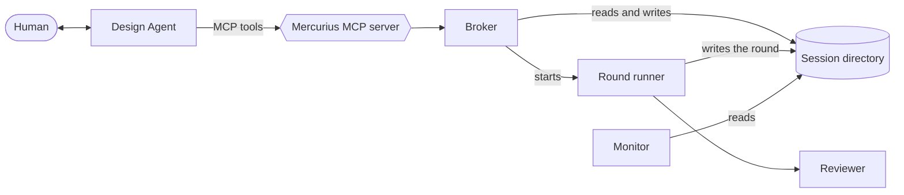

# Architecture and Storage

## Components



The session directory is the only session state Mercurius has. The server holds nothing between tool calls: every tool call resolves the configuration, finds the session directory, reads what it needs, acts, and writes. Any server process can serve any session, so a session survives the server that opened it, and a session opened under one harness can be triaged and closed under another.

The broker owns configuration resolution, prompt assembly, artifact snapshots, and the round's inputs. The round runner owns reviewer dispatch, validation, and the round's outcome. Reviewer implementations only run an underlying reviewer and return raw structured output. Rounds currently run inside the server process, in a goroutine started through the in-process launcher; a round therefore ends if the server process dies, and the next reader records it as lost (see The Runner Lock).

## Session and Round Model

A **session** is a light grouping of related rounds. It owns an id, a folder, and an open/closed lifecycle. It does not own artifacts, decisions, a reviewer, or any state shared between rounds.

A **round** is the atomic review unit. It owns its artifacts, snapshot, prompt, the reviewer and finding limit it ran with, its calibration, its reviewer output, and optional commentary/decisions. Rounds are single-shot: one round dispatches one review.

Nothing flows between rounds within a session: no decisions log carry-forward, no prior-decisions prompt block. To iterate, run another round in the same session with updated artifacts, or close the session and open a new one. Both are valid.

Configuration is per round. The reviewer, `max_findings`, `review_context`, `review_focus`, and `settled_decisions` are resolved from `mercurius.yaml` when a round starts and recorded in that round's `_run.json`, so an edit to any of them takes effect on the next round, and every round's record says what it actually ran with.

## Round Lifecycle

`start_review_round` does its checking up front, and anything that fails before the round is handed to its runner is returned directly from the tool call and leaves no round behind.

1. Resolve `mercurius.yaml`. A missing or unparseable file, or one that names no reviewer, is a `user_error`.
2. Check the session id, read `session.json`, and refuse a closed session.
3. Validate the artifacts.
4. Take the project's runner lock. If it is held, refuse with `conflict` naming the running round.
5. If the round named in the lock file's note is still marked running, record it failed with reason `runner_lost`.
6. Remove any round directory in this session with no `_state.json` (a leftover from a server that died while preparing it), and number the new round one more than the highest round directory left.
7. Write this round's note into the lock file.
8. Create `round-NN/`: snapshot the artifacts, write `_prompt.md` (the assembled prompt), `_config.yaml` (the exact project config bytes), and `_run.json` (the round's inputs).
9. Write `_state.json` as `running`. The round exists from this moment.
10. Hand the round directory and the lock to the runner, and return.

The runner then reads `_run.json` and `_prompt.md`, builds the reviewer from the reviewer block recorded in `_run.json`, dispatches it under the round timeout, validates the raw output against the JSON schema, readiness consistency, and the finding limit, and writes the outcome:

- on success, `_review.json` and `_round.md`, then `_state.json` as `completed`;
- on failure, whatever the reviewer produced to `_raw.txt`, then `_state.json` as `failed` with the stored error.

`_state.json` is always written last, so a round that says `completed` has its outcome on disk. The runner releases the lock when it finishes.

### The round timeout

Every round is bounded by `reviewer.timeout` (default `20m`). When the deadline passes, the reviewer's context is cancelled and its process is killed. If the reviewer had already produced a valid review, the round completes with it: a finished review is not thrown away because its process failed to exit. Otherwise the round fails with `reviewer_failed` and `details.reason: timeout`. The default errs long on purpose; a timeout that fires early throws away a good review, while one that fires late only holds the lock a while longer.

### Failed rounds stay

A round that was started keeps its directory and its number, whatever happened to it. Round 2 fails, stays on disk as failed, and the retry is round 3. The failure is recorded in `_state.json`; the reviewer's output, if any, is in `_raw.txt` beside it. `collect_round` on a failed round returns that failure, from disk, for as long as the directory exists. The synopsis lists failed rounds with the rest.

The stored error is kept small. `details.cause` is cut to 8 KiB with a marker saying so, and raw reviewer output is never stored in an error; `details.raw_path` points at `_raw.txt` instead.

## The Runner Lock

One round runs at a time per log destination. The lock is a kernel `flock(2)` on `<log_destination>/runner.lock`, held for the round's whole life and released by the kernel when its holder closes it or exits, however it exits. Mercurius does no pid probing and writes no heartbeats.

The lock answers two questions:

- **Is a round running?** If the lock is held, yes. `start_review_round` refuses with `conflict`, built from the lock file's note and the named round's state: which session and round is running, when it started, how long it has been running, the monitor command for that session, and a `next_action` saying to wait and then `collect_round` on that session. The round is not lost, so the right move is to collect it rather than relaunch it.
- **Is this round dead?** A round whose state says `running` while the lock is free has no runner. When `collect_round`, `session_status`, or `close_session` finds a session's latest round running, it makes one attempt at the lock; if it gets it, it re-reads the round's state while holding the lock and, if the state still says running, records the round failed with `reviewer_failed` and `details.reason: runner_lost`. The re-read matters: a runner writes its final state and then lets go, so a state read before the lock was taken can be stale.

The lock is therefore also the permission to write a running round's state; nothing touches `_state.json` without holding it. The monitor makes the same attempt read-only and never writes: it prints such a round as lost and leaves it for the next server call.

The guard is project-wide rather than per session on purpose. The path duplicate launches actually take is a new session: an agent loses the session id, or gets an error, opens a fresh session, and launches there. A per-session guard never sees that. The cost is that two harnesses cannot run reviews at the same moment in one project; separate worktrees each resolve their own log destination and so get their own lock.

The lock file's content is a note about the current holder (`session_id`, `round_number`, `server_pid`, `started_at`). The note is rewritten in place through the held descriptor; the file is never replaced, because the lock belongs to the file's inode.

## Prompt Ownership

The broker is the only owner of the prompt. Reviewers receive an assembled `ReviewRequest` with:

- `Prompt`
- `Artifacts`
- `Schema`
- `SessionMeta` (session id + round number)

The current prompt always includes these sections in order:

- Role and readiness frame.
- Review context.
- Settled decisions (only when guards are configured).
- What to flag.
- Fix sizing.
- Project-specific focus.
- Artifacts under review.
- Verdict and severity definitions.
- Finding budget.
- Output instruction and JSON schema.

Artifact contents are inlined inside dynamic backtick fences so markdown artifacts containing code fences do not corrupt the prompt.

The assembled prompt is written to `<session_dir>/round-NN/_prompt.md` when the round is prepared, and the runner reads it back from there, so the prompt the reviewer received and the prompt on disk are the same bytes. The leading underscore reserves a namespace for broker-emitted meta files inside the round directory; artifact names cannot begin with `_`. The round log frontmatter includes a `prompt_path` field pointing at this file.

## Session Directory Layout

```text
<log_destination>/
  runner.lock            held by the running round; its content names that round
  <session_id>/
    session.json         the session's own facts: opened, closed
    _synopsis.md         written by close_session
    round-01/
      _state.json        running, completed, or failed; timings; the stored error
      _run.json          the round's inputs: reviewer, max_findings, calibration presence, manifest
      _config.yaml       the project's mercurius.yaml, verbatim
      _prompt.md
      design
      work-order
      _review.json       the outcome, on success
      _round.md
      _raw.txt           the reviewer's raw output, on failure
      _notes.json        triage, written by record_round_notes
      _notes.md
```

Each fact has one home, and the homes are divided by who writes them. `session.json` carries what belongs to the session and nothing else: its id, when it opened, and whether and when it closed. A round directory carries everything about that round. The server writes the inputs and the round's first state; the runner writes the outcome and the final state; `record_round_notes` writes the notes later.

The human documents each have a machine twin written in the same motion: `_review.json` beside `_round.md`, `_notes.json` beside `_notes.md`. Mercurius reads the twins and never parses its own markdown back. The refs a round accepts for decisions are not stored; they are recomputed from the raw output in `_review.json` through the same schema parse that produced them. The artifact manifest is an input, known before the reviewer runs and as true of a failed round as of a completed one, so it lives in `_run.json`.

A round exists once its `_state.json` exists. A round directory without one is a leftover from a server that died while preparing it; it is not listed, and the next `start_review_round` in that session removes it.

`_config.yaml` is the exact `mercurius.yaml` bytes this round ran with, captured beside the rendered prompt so the round's input and output sit together: a guard present in `_config.yaml` but absent from `_prompt.md` (rendered empty) stays diagnosable after the fact. Because it is the raw config, `_config.yaml` and `_run.json` can contain `reviewer.binary_path`, `model`, or `extra_args`; the `.mercurius/` tree is local and gitignored, so treat it accordingly. Other files in the round directory are the snapshotted artifacts under their declared names.

All JSON files are written through a temporary file renamed over the target, so a reader never sees a partial file. Session ids from tool calls and from `monitor --session` are checked against `^s_[A-Za-z0-9]{12}$` before they are joined into a path; anything else is `not_found`. A matching directory with no `session.json` is `not_found` with a detail saying it is not a session in this layout; sessions written by older Mercurius versions are not read. A `session.json`, `_run.json`, or `_state.json` that exists and cannot be parsed is an `internal_error` naming the file.

## Round Logs

Each completed round writes a markdown log at `<session>/round-NN/_round.md`:

- YAML frontmatter with session id, round number, opened timestamp, verdict, prompt path, and reviewer names.
- Artifact manifest table.
- Reviewer output sections with usage notes and raw JSON.

The log is immutable after creation. Recording commentary and decisions through `record_round_notes` writes `_notes.json` and `_notes.md` rather than mutating the log.

## Session Synopsis

`close_session` writes a session-level summary at `<session>/_synopsis.md`, rendered from the session directory's machine files, so it works from any server process. The file opens with YAML frontmatter (session id, opened/closed timestamps, round count, and the failed-round count when any failed), followed by a skimmable Summary section, a Round outcomes table with one row per round (its state, reviewer, verdict, finding counts, decisions, and notes), and a per-round detail block that restates the round's state, reviewer, calibration presence, verdict, findings, decisions, and commentary. A failed round gets a row and a short detail block with its stored error and the path to `_raw.txt`. There is no session-level reviewer; the reviewer is reported per round. If a completed round's reviewer output fails to parse, the synopsis emits a stable fallback pointing at that round's `_review.json`. The per-round files remain the authoritative record.

## Reviewer Implementations

Current implementations:

- `codex`: runs the local `codex` CLI as a subprocess.
- `claude`: runs the Claude Code CLI (`claude`) as a subprocess.
- `pi`: runs the [pi](https://pi.dev) coding agent as a subprocess.
- `dummy`: returns a fixed valid response for tests and scaffolding.

Every reviewer is given the same broker-assembled prompt (which inlines the artifact content and the output schema) and returns the best JSON object it can. Reviewers perform output extraction only; canonical schema validation belongs to the runner, which validates the returned object after the reviewer returns. The shared `internal/reviewer/jsonout` package holds the JSON-object extraction logic used across reviewers.

The three subprocess reviewers share two behaviors:

- **Failures carry their output.** A failed process, or a clean exit whose output cannot be parsed, returns an error carrying the bytes the reviewer captured (stdout and stderr, and for codex the last-message file), instead of folding them into the error message. The runner writes those bytes to `_raw.txt`, so the stored error stays short.
- **The wait is bounded.** Each reviewer's subprocess has a ten-second wait delay: once the reviewer exits or its deadline passes, Mercurius waits at most that long for its output pipes to close before closing them itself. Without it, a process the reviewer started could hold the pipes open and keep the round running indefinitely. A reviewer that wrote a valid result and exited, leaving a child behind, still completes its round. The child is not killed.

The Codex reviewer runs `codex exec` with:

- ephemeral session
- read-only sandbox
- JSON schema file supplied through `--output-schema`
- final message captured through `--output-last-message`
- assembled prompt delivered on stdin

The Claude reviewer runs `claude -p` with:

- `--output-format json` and native `--json-schema` enforcement
- `--permission-mode plan` (read-only) and `--no-session-persistence` (ephemeral)
- assembled prompt delivered on stdin
- the schema-validated object read from the envelope's `structured_output` field, falling back to extracting a JSON object from the `result` text

`--bare` is intentionally not passed, so claude inherits the operator's logged-in credentials; a logged-out operator surfaces as a clear reviewer error. Usage notes record the model, subtype, cost, turn count, and duration.

The pi reviewer runs `pi -p --mode json` with:

- `--no-session` (ephemeral) and `--no-context-files` (so the project's `AGENTS.md`/`CLAUDE.md` above the round directory do not colour the review)
- `--tools read,grep,find,ls` (read-only)
- the assembled prompt passed as an `@file` reference, with stdin closed
- the final assistant message parsed out of the JSON event stream, then the JSON object extracted from it

pi has no native JSON-schema enforcement, so the schema is carried only by the prompt and the broker's post-return validation is the backstop.

### Working directory and project context files

Every reviewer runs with its working directory set to the round's snapshot directory (`<session>/round-NN/`), which sits inside the project tree. The reviewers differ in how much of the surrounding project they pull into the review:

- `codex` and `claude` discover and load the project's agent context files (`AGENTS.md` for codex; `CLAUDE.md` for claude, which falls back to `AGENTS.md` when no `CLAUDE.md` is present) by walking up from the working directory, so a review carries whatever instructions those files hold. Codex runs with an isolated `CODEX_HOME`, and claude is not run with `--bare` (so it uses the operator's login); neither suppresses context-file discovery.
- `pi` is run with `--no-context-files`, so it does not load `AGENTS.md`/`CLAUDE.md` and reviews the artifacts on their own merits.

This is a deliberate, tunable difference rather than a guarantee of identical context across reviewers. The artifact content itself is always inlined into the prompt, so context-file discovery only adds the project's own agent instructions, not the artifacts. An operator who wants codex/claude to review without that surrounding context can suppress it per reviewer (for example, run claude with `--bare` plus `ANTHROPIC_API_KEY` via `extra_args`).
