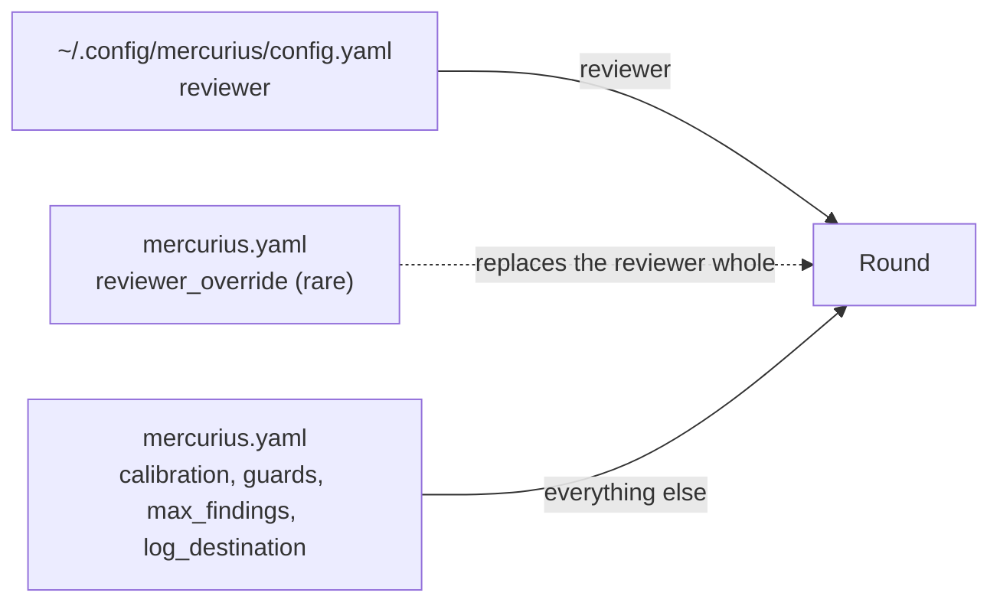

# Configuration

Mercurius reads two files, and each holds one kind of fact.

- **The user-level config**, `~/.config/mercurius/config.yaml`, holds the reviewer. Which reviewer runs is a fact about the installation (which harnesses are installed, which model you want, how long that model takes), so it is set once and every project uses it.
- **The project config**, `mercurius.yaml`, holds what describes the project and the review arc: calibration, guards, the finding limit, and where the logs go. It is scaffolded per arc and names no reviewer.



Neither file is read at startup. Every tool call reads both, so the server starts in a project with no `mercurius.yaml`, and an edit to either file takes effect on the next call. A missing or broken file is a `user_error` from the tool call naming the file at fault, rather than a server that fails to launch. Write or fix the file and call again; the harness does not need to reconnect. Each round records the reviewer, `max_findings`, and calibration it ran with in its `_run.json`.

## The User-Level Config

### Location

The path is the operating system's user config directory joined with `mercurius/config.yaml`: `$XDG_CONFIG_HOME/mercurius/config.yaml` when `XDG_CONFIG_HOME` is set, and `~/.config/mercurius/config.yaml` otherwise, on Linux. Write a starter with:

```sh
mercurius bootstrap --user
```

It writes the starter only if no file is there; `--force` overwrites one.

A missing user-level file is not an error: it means no reviewer is configured. `open_session` still succeeds and reports no reviewer; `start_review_round` answers `user_error` naming the user-level path.

### Example

```yaml
reviewer:
  name: codex
  impl: codex
  model: gpt-6.1-sol
  timeout: 20m
```

### The reviewer block

Required when the block is present:

- `name`: the reviewer's name (free-form). It appears in round logs, `session_status`, and the synopsis.
- `impl`: the reviewer implementation: `codex`, `claude`, `pi`, or `dummy`.

Optional:

- `model`: the model string passed to the reviewer. `codex` takes a model id (for example `gpt-6.1-sol`); `claude` takes an alias or full name (for example `sonnet` or `claude-opus-4-8`); `pi` takes the `provider/model` form (for example `openai-codex/gpt-6.1-sol`). Omitted means the binary's own default.
- `binary_path`: the reviewer binary. Omitted means normal executable lookup of the impl's default binary (`codex`, `claude`, or `pi`). A relative path resolves against the directory of the file that declares it.
- `extra_args`: additional reviewer-specific CLI arguments, appended after the Mercurius-managed flags.
- `timeout`: how long one round may run, as a duration string such as `20m` or `45m30s`. Default is `20m`. At the deadline the reviewer's process group is killed; a round whose reviewer had already produced a valid review completes with it, and any other round fails with `reviewer_failed` and `details.reason: timeout`. The default errs long on purpose: a timeout that fires early throws away a good review, while one that fires late only holds the project's runner lock a while longer. It lives in the reviewer block because how long a review takes depends on which reviewer runs it.

The reviewer is resolved at the start of every round, so editing this file changes the reviewer of the next round in every project. Nothing stops a reviewer change mid-arc; each round's reviewer is recorded and reported, so a switch is visible in `session_status` and the synopsis.

## The Project Config

### Location

By default the CLI looks for `./mercurius.yaml`; pass another path with `--config`. `mercurius bootstrap` writes a starter into the current directory, without a reviewer.

### Example

```yaml
log_destination: ./reviews
max_findings: 8
review_context: |
  Deployment: personal tool, single supervised implementer.
  Preference: simple over highly defensive when both achieve correctness.
settled_decisions:
  - id: observability-out-of-scope
    do_not_flag: missing production-grade observability or multi-tenant concerns
review_focus: |
  Pay particular attention to invariants specific to this project that the
  universal what-to-flag criteria do not already cover.
```

Every field is optional; an empty file is a valid project config.

### Fields

- `log_destination`: directory where sessions, rounds, and snapshots are written, and where the project's `runner.lock` lives. Default is `.mercurius`, relative to the config file's directory. One round runs at a time per log destination.
- `max_findings`: maximum blocking findings across `concerns` plus `questions` in a successful round. Default is `6`. Advisory notes do not count.
- `review_context`: free-form markdown calibration, the stable framing of what kind of review this is (deployment model, stakes, scope, simplicity-vs-defensiveness preference). It does not hold guards; decisions the reviewer should stop raising go in `settled_decisions`.
- `settled_decisions`: a list of guards, decisions already made that the reviewer should not re-raise. Each entry is `{id, do_not_flag}`: `do_not_flag` is the instruction rendered into the prompt as its own block; `id` is an operator-side handle for finding, editing, or removing the guard and is never shown to the reviewer. Entries whose `do_not_flag` is empty are ignored, and duplicate ids are tolerated. Earn guards by re-litigating a finding and deciding it is out of scope; do not add them speculatively, since a ledger that outgrows the artifacts slows every cold read.
- `review_focus`: free-form markdown for project-specific things to look for that the base review philosophy does not already cover (typically one paragraph). Inserted in the project-specific focus section of the prompt.
- `reviewer_override`: a reviewer block that replaces the installation's reviewer for this project. See below.

`review_context`, `review_focus`, and `settled_decisions` are configuration-only; they are not MCP tool inputs. Mercurius resolves the file at the start of every round, so editing any of them between rounds takes effect on the very next round with no session reopen. Hand-editing `settled_decisions` between rounds is the way to amend the settled context mid-arc; there is no separate amend tool. A broken or unreadable file fails `start_review_round` with a `user_error` naming the problem and leaves the session active, so a fixed file simply succeeds on the next try. Each round snapshots the project file's exact bytes as `_config.yaml` in its round directory.

### No reviewer block

A plain `reviewer` block in `mercurius.yaml` is an error. Every tool answers `user_error`, naming the user-level path and saying to remove the block from the project file. The reviewer is set per installation, and a project file is scaffolded fresh for every arc; a reviewer in it would have to be set correctly every time by whoever writes the file, and a stale template or an agent's habit would quietly decide which reviewer runs.

### Overriding the reviewer for one project

A project can still choose its own reviewer, deliberately, with a `reviewer_override` block:

```yaml
reviewer_override:
  name: second-opinion
  impl: claude
  model: sonnet
```

It takes the same fields as the user-level `reviewer` block, and it replaces that block whole, timeout included. The two are never merged field by field: merging would let the installation's `model` land on the override's different `impl`. A relative `binary_path` in the override resolves against the project file's directory.

An override is said everywhere the reviewer is named. `open_session` and `start_review_round` report the reviewer's `source` as `project override` (or `user config` otherwise), and the launch response tells the agent to tell you the round is running on an override. `_run.json` records `reviewer_source` for the round, `session_status` reports it per round, the monitor prints it, and the synopsis marks every round that ran on an override. When the block comes out, the next round is back on the installation's reviewer.

The key is deliberately not `reviewer`. If it were, every stale template and every agent habit would produce an override, and overriding would be the accident rather than the decision.

## Removed Fields

The project config loader rejects files that still include these keys with a clear error:

- `reviewer` (in the project file): the reviewer is set in the user-level config; remove the block.
- `reviewers` (array): likewise; the reviewer is set in the user-level config.
- `default_budget`: rounds are single-shot and no longer share a budget across a session.
- `prompt_overrides`: renamed to `review_focus`.

## Project Name

The project name is derived from the basename of the directory containing the project config (e.g., a config at `~/work/archive/mercurius.yaml` produces project name `archive`). This name is what the MCP server reports in its handshake, computed from the path without reading the file; rename the directory to rename the server identity.

## Path Resolution

Relative paths resolve against the directory of the file that declares them, not the shell's current working directory: `log_destination` and an override's `binary_path` against the project config's directory, and the user-level `binary_path` against the user-level config's directory. Paths beginning with `~/` expand against the user's home directory. `open_session` creates the `log_destination` leaf directory when the parent exists and is writable; no other call or command creates it.
