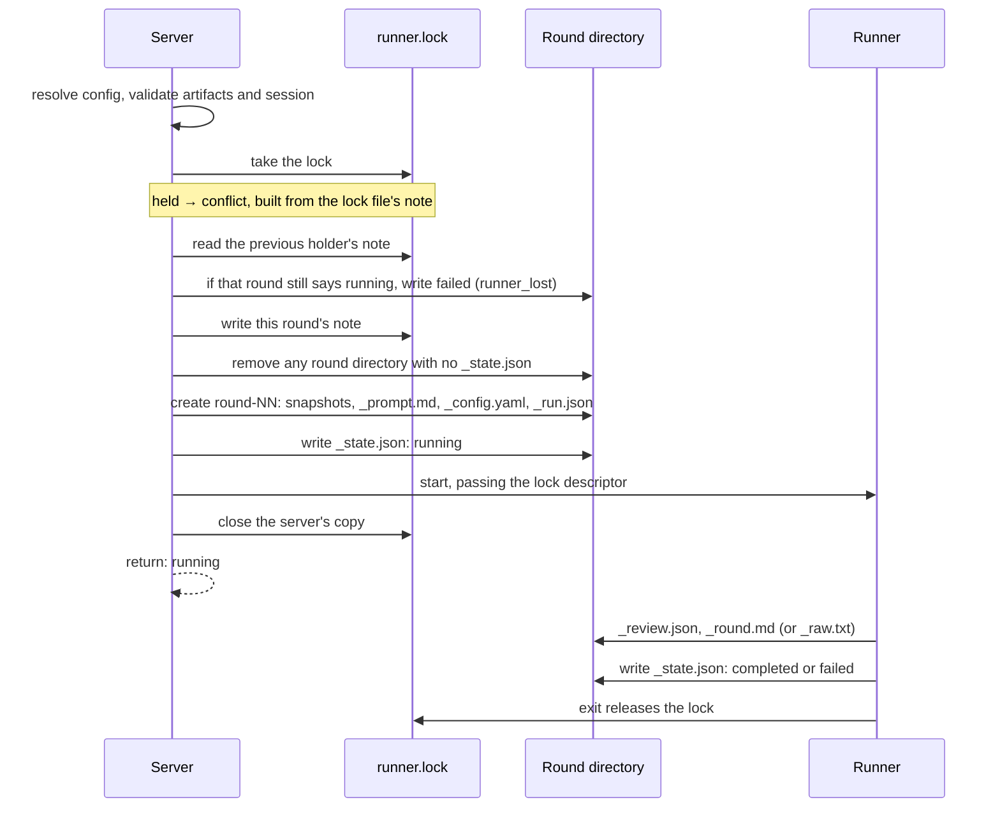

# Sessions on Disk — Work Order

This is the implementation plan for `docs/future/sessions-on-disk.md`. The spec holds what is being built and why. This document holds how: what the code looks like today, the file shapes, the lock protocol, the package changes, the tests, and the stages.

Nothing here is implemented.

## What exists today

The facts below were read from the code and are what the plan is built against.

- **The registry.** `broker.Broker` (`internal/broker/broker.go`) holds `sessions map[string]*session` behind one mutex. A `session` holds its rounds, and each `round` holds the manifest, the raw reviewer results, the valid refs, the decisions, and the commentary. None of the round payload is on disk in machine form.
- **The round.** `StartReviewRound` builds a `roundJob` and runs `executeRoundJob` in a goroutine. The goroutine snapshots the artifacts, builds the prompt, writes `_prompt.md` and `_config.yaml`, calls `reviewer.Review` with `context.Background()`, validates, and writes `_round.md`. There is no timeout.
- **Failure.** Every failure path after snapshotting calls `cleanupRoundDir`, which removes the round directory. The round number is `len(s.rounds) + 1`, so a failed round's number is reused. The failure is kept only on `session.lastError` and on the in-memory `lastRoundJob`, which is what `CollectRound` answers a failed round from.
- **`status.json`.** `persistSessionLocked` rewrites it through `monitor.WriteStatus` on every mutation, including refused tool calls. It is written from `session.status()`, which fills the reviewer and `max_findings` from `Broker.options`, not from the session.
- **Failure payloads.** Schema and finding-limit failures put the whole raw output in the error's `details.raw`. Reviewer process failures put the whole of stdout and stderr in the error string (`commandOutputSuffix` in each reviewer). Both land in `status.json` and in the tool error.
- **Discarded output.** When a reviewer exits cleanly but its output cannot be parsed, the output is dropped and only the parse error is returned. The codex reviewer reads its last-message file, fails to extract an object, and removes its temporary directory. The claude and pi reviewers return the envelope or extraction error without the stdout they captured.
- **The reviewer.** `mcpserver.BrokerOptions` calls `buildReviewer` once and stores the result on `broker.Options`. The three subprocess reviewers start their child with `exec.CommandContext` and no `SysProcAttr`, so nothing ties the child to its parent. Each captures stdout and stderr into a `bytes.Buffer` and sets no `WaitDelay`, so `cmd.Wait` returns only when those pipes reach end of file, which a process the reviewer started can hold off indefinitely after the reviewer itself has exited.
- **Config.** `config.LoadWithRaw` reads one file, requires a `reviewer` block, and rejects renamed keys in `checkRenamedFields`. The root command in `cmd/mercurius/main.go` loads the config before starting the server and exits if it cannot, which is why the server is dead in any project with no `mercurius.yaml`. Calibration alone is re-read per round, through `mcpserver.CalibrationProvider`.
- **The monitor.** The `monitor` subcommand reads `status.json` through `internal/monitor`, and `--wait` polls it once a second.
- **Session ids as paths.** A session id from a tool call is only ever a map key today. `monitorSession` already joins the `--session` flag into a path without checking it.
- **Tests.** `internal/broker/broker_test.go` and `internal/mcpserver/mcpServer_test.go` inject reviewers as Go values (`scriptedReviewer`, `blockingReviewer`, `fixedReviewer`, `failingReviewer`) through `broker.Options.Reviewer`. `internal/mcpserver/reviewerRoundIntegration_test.go` does the same with the real claude reviewer, behind the `integration` build tag, so `make test` does not compile it.

## Mechanics

These apply across the stages. Each stage says which of them it lands.

### Files

All JSON files are written by one helper that writes a temporary file in the same directory and renames it over the target, which is what `monitor.WriteStatus` does today. Field names are `snake_case`.

This work order does not say which library binds these files, and `encoding/json` with json tags is acceptable for it. Moving them, the MCP payloads, and the review-output parse onto `dd` is separate work, on the roadmap card `bind-project-data-through-dd`. The terminus rubric holds `golang-conventions/df-binding` as advisory until that card is done, so its findings on code written here are expected and are answered by pointing at the card.

`session.json`, in the session directory:

| field | meaning |
| --- | --- |
| `session_id` | the id, repeated so the file stands alone |
| `opened_at` | RFC 3339 |
| `state` | `active` or `closed` |
| `closed_at` | present once closed |

`_run.json`, in the round directory, written once by the server and never changed:

| field | meaning |
| --- | --- |
| `session_id`, `round_number` | identity |
| `opened_at` | when the server prepared the round |
| `server_pid` | the server that prepared it |
| `reviewer` | `name`, `impl`, `model`, `binary_path`, `extra_args`, `timeout` — fully resolved |
| `reviewer_source` | `user config` or `project override` (stage 3) |
| `max_findings` | the finding limit for this round |
| `review_context_present`, `review_focus_present` | calibration presence for this round |
| `manifest` | one entry per artifact: `name`, `source_path`, `snapshot_path`, `size`, `hash` |

`_state.json`, in the round directory:

| field | meaning |
| --- | --- |
| `state` | `running`, `completed`, or `failed` |
| `started_at`, `updated_at`, `completed_at` | timings |
| `runner_pid`, `reviewer_pid` | for the operator; never used to signal a process |
| `outlived_server` | set by the runner at finish (stage 2) |
| `error` | on failure: `code`, `message`, `details`, `at` |

`_review.json`, written on success: `reviewers`, a list of `{reviewer_name, raw, usage_notes}`. It is a list from the start so a later multi-reviewer round needs no new shape.

`_notes.json`, written by `record_round_notes`: `commentary`, `decisions` (a list of `{ref, disposition, note}`), `recorded_at`.

`runner.lock`, in the log destination: `session_id`, `round_number`, `server_pid`, `started_at`. The content is a note about the current holder. The lock itself is the kernel's.

A round **exists** once its `_state.json` exists. A round directory without one is a leftover from a server that died while preparing it, and is removed by the next `start_review_round` in that session, which holds the lock when it does so.

The error stored in `_state.json` is kept small. `details.cause` is cut to 8 KiB with a marker saying so, and `details.raw` is never stored. The reviewer's output goes to `_raw.txt` in the round directory, and the error's details carry `raw_path`. The cap is a backstop; once the reviewers stop putting output in their error messages, as below, causes are short.

### Failure codes

No new error codes. A round's failure is stored with one of the existing five:

| what happened | code | `details.reason` |
| --- | --- | --- |
| reviewer process failed, or output failed validation | `reviewer_failed` | absent |
| the timeout fired with no valid review in hand | `reviewer_failed` | `timeout` |
| the runner was found dead | `reviewer_failed` | `runner_lost` |
| the runner could not write its outcome | `internal_error` | absent |

`collect_round` on a failed round returns the stored error as a tool error, with `round_number`, `state_path`, and `raw_path` added to the details.

`record_round_notes` is for completed rounds. On a failed round it answers `conflict`, since a failed round has no refs to decide and its record is the failure itself. On a running round it answers `conflict` as it does today.

### The runner lock

`internal/runlock` wraps `flock(2)` on `<log_destination>/runner.lock`, through the standard library's `syscall.Flock`. The lock belongs to the open file description, so a child that inherits the descriptor shares the lock, and the lock is released when the last copy of the descriptor is closed. Three rules follow. Each has a named test that fails if the rule is broken: the first two in stage 2, where the handoff exists, and the third in stage 1.

1. **The server closes its copy after the handoff.** If it kept it, the lock would stay held for as long as the server lived, and every later launch in the project would be refused.
2. **The runner marks the inherited descriptor close-on-exec before it starts anything.** A descriptor passed through `exec.Cmd.ExtraFiles` arrives without that flag. If the runner left it clear, the reviewer would inherit the lock.
3. **A process that takes the lock to check a round re-reads the round's state after taking it.** The runner writes its final state and then exits, so a state read before the lock was taken can be stale.

Taking the lock is a non-blocking attempt, retried up to five times 50 ms apart before it is reported as held. The retry exists because a server marking a dead round, or a monitor checking one, holds the lock for a moment.

When the lock is held, the `conflict` is built from the lock file's note and from the named round's `_state.json`. Its details carry `running_session_id`, `running_round_number`, `started_at`, `running_for`, `runner_pid`, `started_by_this_server` (stage 2), the monitor command for that session, and a `next_action` that says to wait and then call `collect_round` on that session. If the note cannot be read, the `conflict` is returned without them.

`start_review_round`, in order:

The round number is one more than the highest existing `round-NN` in the session, counted after the leftover directories are removed. The project-wide lock serializes every round start, so there is no second allocator to race.

Only one round can be marked `running` with the lock free: the one named in the lock file's note, since every round that ever ran was named there when it started. That is why the server checks that one round and does not scan the log destination.

What each death leaves, and what reads it next:

| the process dies… | on disk | next reader |
| --- | --- | --- |
| after taking the lock, before `_state.json` | a round directory with no state | removed by the next start in that session |
| after `_state.json`, before the runner starts | `running`, lock free | marked `runner_lost` |
| the runner, mid-review | `running`, lock free | marked `runner_lost` |
| the runner, after its final state write | `completed` or `failed`, lock free | read as is |

If starting the runner fails outright, the server still holds the lock: it removes the round directory, releases the lock, and returns `internal_error`. No round was created.

The read tools mark a dead round too. When `collect_round`, `session_status`, or `close_session` finds the session's latest round `running`, it makes one attempt at the lock. If it gets the lock, it re-reads the state, writes `runner_lost` if the state is still `running`, and releases. This check is one function in `internal/broker`, used by every caller, and it takes the lock through a function it is handed, so a test can change the round's state in the gap between the check's first read and its hold on the lock. The monitor makes the same attempt and releases without writing; it prints the round as lost. It opens the lock file read-only and never creates it; a missing lock file means the lock is free.

### The runner

`internal/runner` holds `Run`, which takes a round directory and the lock and does everything from dispatch to the final state write. It reads `_run.json` for the reviewer and the limit, `_prompt.md` for the prompt, and recomputes the output schema from `max_findings` with `schema.ReviewOutputSchemaWithMaxFindings`, which is what `prompt.Build` returns today.

`Run` is reached through a `Launcher`, which is the seam the broker starts a round through:

- The **in-process launcher** runs `Run` in a goroutine and takes a reviewer factory, so tests can supply reviewers as Go values exactly as they do now. Stage 1 ships this as the only launcher.
- The **process launcher** starts `mercurius run-round --round-dir <dir>`, a hidden subcommand, using `os.Executable()`. Stage 2 adds it and makes it the production launcher.

The process launcher sets `Setsid` so the runner gets its own session and process group, attaches `/dev/null` to stdin, opens `_runner.log` in the round directory for stdout and stderr, and passes the lock as the one entry in `ExtraFiles`. After `Start` it closes its copy of the lock and waits on the child in a goroutine, so a finished runner is reaped while its server is still alive.

The reviewer's subprocess settings live in one helper in `internal/reviewer` that all three subprocess reviewers call on their `exec.Cmd`. It arrives in two parts.

In stage 1 it sets `cmd.WaitDelay` to 10 seconds. Without it the timeout is not a bound: once the reviewer has exited, the context no longer applies, and `Wait` blocks for as long as any process the reviewer started holds an output pipe open. With it, `Wait` closes the pipes and returns ten seconds after the reviewer exits or the deadline passes, whichever comes first. The value is held in a package variable so tests can shorten it. `Wait` then returns an error, which the reviewers already treat as they treat any process error: a parsed result is still returned, and otherwise the failure carries the output.

In stage 2, on Linux, it also sets `Pdeathsig: SIGKILL` and `Setpgid`, and sets `cmd.Cancel` to kill the process group, so the timeout takes the reviewer's own children with it. On other platforms this second part does nothing. The parent-death signal follows the thread that forked the child, not the process, so both launchers lock the calling goroutine to its OS thread for the whole of `Run`, and `Run` runs the reviewer synchronously on that goroutine. Without that, the Go runtime can retire the thread and the kernel kills a healthy reviewer.

The reviewers report their child's pid through a new optional `Started func(pid int)` on `reviewer.ReviewRequest`, called after the child starts. The runner uses it to record `reviewer_pid`. This means the three reviewers move from `cmd.Run` to `cmd.Start` and `cmd.Wait`.

A reviewer's failure carries its output. `internal/reviewer` gains one error type, `OutputError`, holding the underlying error and the bytes the reviewer captured. The three subprocess reviewers return it from every failure where they hold output: a failed process (stdout and stderr), and a clean exit whose output cannot be parsed (stdout, and for codex the last-message bytes, read before its temporary directory is removed). They stop appending output to the error message, and `commandOutputSuffix` is removed from all three. `Run` writes the carried bytes to `_raw.txt`. When `Review` succeeds and validation fails, `Run` writes the returned raw object there instead.

The timeout is a context deadline on the `Review` call. The default is 20 minutes, held as `config.DefaultReviewerTimeout`. All three subprocess reviewers already return a parsed result when their process ends badly, and that stays: a reviewer that wrote a valid review and then hung is killed at the deadline and its round completes. `Run` records `reason: timeout` only when the deadline has passed and `Review` returned an error.

`outlived_server` is true when the runner is a separate process from the server and its parent pid at finish is not the `server_pid` in `_run.json`. The comparison is against the recorded pid, not against a reading taken at startup, because a server that dies before the runner's first line runs would make both readings name the adopting process. Under the in-process launcher the runner's own pid is the `server_pid`, and the mark is false.

### Config

`config.Resolve(projectPath, userPath)` replaces `Load` and `LoadWithRaw`. It returns the project settings, the resolved reviewer or none, where the reviewer came from, and the project file's exact bytes. The reviewer being absent is not an error in `Resolve`. `start_review_round` turns it into one.

Every broker operation calls `Resolve`. The server keeps the two paths and nothing else. The server's MCP name is the base name of the directory holding the project config path, computed from the path without reading the file.

The user-level path comes from `os.UserConfigDir()`, which honors `XDG_CONFIG_HOME`, joined with `mercurius/config.yaml`. It is resolved once in `cmd/mercurius` and passed down, so tests always pass a temporary path and never read the developer's own file.

`reviewer.timeout` is a `time.Duration` field, which `dd` already reads from strings like `20m`. A relative `binary_path` resolves against the directory of the file that declared it.

### Session ids

A session id from a tool call or from `monitor --session` is checked against `^s_[A-Za-z0-9]{12}$` before it is joined into a path. Anything else answers `not_found`. This check is new work the design creates: the map lookup did it implicitly, and a directory lookup does not.

A directory that matches but has no `session.json` answers `not_found` with a detail saying the directory is not a session in this layout. A `session.json`, `_run.json`, or `_state.json` that exists and cannot be parsed answers `internal_error` naming the file.

## Stage 1 — the server holds nothing

The registry goes away. Sessions and rounds live in the new layout, any server process can serve any session, and the server starts with no config. Rounds still run inside the server process, through the in-process launcher.

**Changes**

- **`internal/store` (new).** The file shapes above, the atomic write helper, session and round path helpers, the session id check, and readers that list a session's rounds and a log destination's sessions. No process logic.
- **`internal/runlock` (new).** Take with retry, release, read and write the note. Built for unix.
- **`internal/runner` (new).** `Run`, the `Launcher` interface, the in-process launcher, and `buildReviewer`, moved here from `internal/mcpserver`.
- **`internal/reviewer`.** `OutputError`, and the shared subprocess helper with its `WaitDelay`. The codex, claude, and pi reviewers return the one and call the other.
- **`internal/broker`.** The `sessions` map, the mutex, `session`, `round`, and `roundJob` are removed. The six operations keep their names and become functions over `internal/store`. `Options` becomes the two config paths and a `Launcher`. `StartReviewRound` follows the sequence above. Failed rounds are no longer removed.
- **`internal/config`.** `Resolve` as above, still reading the reviewer from the project file's `reviewer` block; the user-level path is accepted and not read until stage 3. Until then, a `start_review_round` with no reviewer configured returns `user_error` naming the project file. `reviewer.timeout` is added. The duplicate `ensureLogDestination` in `internal/broker` is dropped in favor of the one here, and only `open_session` creates the log destination.
- **`internal/mcpserver`.** `New` takes the paths and never fails for want of a config. `CalibrationProvider` and `ConfigCalibrationProvider` are removed. The tool outputs change as the spec's tool-surface section describes: `session_status` loses its session-level reviewer, `max_findings`, presence flags, `last_error`, and `active_round`, and its rounds gain `state`, `reviewer`, `max_findings`, `state_path`, `completed_at`, and `error`. `start_review_round` reports the reviewer block and points `status_path` at `_state.json`.
- **`internal/roundlog`.** The synopsis types lose the session-level reviewer, presence flags, and last error. `SynopsisRound` gains state, reviewer, calibration presence, and failure. Failed rounds get a row and a short detail block.
- **`internal/monitor`.** Removed.
- **`cmd/mercurius`.** The root command stops loading the config. The monitor moves to its own file and reads the store; `--wait` polls the latest round's `_state.json`.

**Tests**

The broker and tool tests are rewritten against the store. Two habits make them prove the design:

- Every step in a broker test uses a **new `Broker` value** on the same directory. A test that passes only because something stayed in memory cannot pass.
- The lifecycle test **deletes `_round.md` and `_notes.md`** before collecting and re-recording notes. Re-recording writes `_notes.md` again, so the test deletes it a second time before closing, and checks that the synopsis carries the commentary and decisions. If anything reads the markdown back, it fails.

Named cases:

- A round fails; its directory, `_state.json`, and `_raw.txt` remain; the next round takes the next number; `collect_round` on the failed round returns the stored error from a new `Broker`.
- A failure carrying 1 MiB of reviewer output leaves a `_state.json` under 16 KiB and every byte of the output in `_raw.txt`.
- For each of codex, claude, and pi, a fake binary that exits cleanly with malformed output produces an `OutputError` holding that output, and a round run through that reviewer leaves those bytes in `_raw.txt`. The existing reviewer tests that look for stderr text in the error message change to look for it in the carried output.
- A second `start_review_round` while a round runs is refused with `conflict` naming the running session and round, **from a different session** and from a second `Broker` on the same directory.
- A `_state.json` hand-written as `running` with the lock free, and the lock file's note naming that round, is marked `runner_lost` by `collect_round`, by `session_status`, by `close_session`, and by the next `start_review_round`. The note matters for the last of these, which checks only the round the note names.
- The dead-round check is run against a round whose state is `running`, with a lock-taking function that writes `completed` to that round's `_state.json` just before it returns the lock. This is the runner finishing between the check's first read and its hold on the lock. The state is still `completed` afterward. A check that decides from its first read overwrites it and fails.
- `record_round_notes` on a failed round answers `conflict` and writes no notes files.
- A round directory with no `_state.json` is removed by the next start and its number is reused.
- A session id of `../x`, of an empty string, and of a valid-looking id with no directory each answer `not_found`, and nothing outside the log destination is read.
- The server starts with no `mercurius.yaml`; `open_session` returns `user_error` naming the path; the file is written; the same client's next call succeeds.
- A reviewer that blocks past a 50 ms timeout and returns an error produces a failed round with `reason: timeout`. A reviewer that blocks past it and then returns a valid result produces a completed round.
- For each of codex, claude, and pi, a fake binary prints a valid result, starts a child that keeps stdout and stderr open, and exits. `Review` returns within the shortened wait delay with the result, and a round run through it completes and releases the lock. Without `WaitDelay` the test hangs. The test kills the leftover child itself when it is done.
- The monitor runs against a log destination whose directories are read-only and prints a lost round without error. It is also run against a writable log destination holding a lost round, and every directory entry and file's contents are the same afterward. The read-only run alone would pass a monitor that tried to write and ignored the error.

`reviewerRoundIntegration_test.go` constructs `broker.Options` directly and has to be updated in this stage. Because `make test` does not compile it, the stage is checked with `go vet -tags integration ./...` as well.

**Docs.** `docs/current/architecture.md` (model, lifecycle, layout, synopsis), `mcp-tools.md`, `operations.md` (monitor, status file, cleanup), `configuration.md` (`reviewer.timeout`), `user-guide.md` (what `open_session` reports), the `docs/current/README.md` summary, and the package list and project context paragraph in `AGENTS.md`. A `CHANGELOG.md` entry under `## Unreleased`.

**Exit.** `make test` and `go vet -tags integration ./...` pass. A session opened by one server process can be collected, noted, and closed by another. A round cut off by the server's death is reported as `runner_lost` and does not block the next round.

## Stage 2 — the round outlives the server

The round moves into its own process.

**Changes**

- **`cmd/mercurius`.** The hidden `run-round` subcommand, in its own file. It marks descriptor 3 close-on-exec, rebuilds the lock from it, locks its OS thread, and calls `runner.Run`. Its logging goes to stderr, which the launcher has pointed at `_runner.log`.
- **`internal/runner`.** The process launcher. `Run` records `runner_pid`, `reviewer_pid`, and `outlived_server`. The in-process launcher locks its goroutine to its OS thread around `Run`, as the `run-round` command does. The server is wired to the process launcher; the in-process launcher stays for tests.
- **`internal/reviewer`.** The helper's second part, in a Linux file with a no-op file for other platforms. The `Started` callback on `ReviewRequest`, which the codex, claude, and pi reviewers call.
- **`internal/roundlog`, `internal/mcpserver`, `internal/broker`.** The synopsis and `session_status` show `outlived_server` per round. The project-wide `conflict`, built in the broker, reports whether the running round was started by the answering server, by comparing the note's `server_pid` with its own.

**Tests**

These need real processes and are Linux-only. The test binary re-executes itself as the runner, and as a stand-in server where one is needed. The reviewer is a shell script named through `binary_path`.

- **The round outlives its server.** A helper process prepares a round, starts the runner, and exits at once, without waiting for the runner to come up. The round completes, and `outlived_server` is true.
- **The lock is let go.** One process starts a round, waits for it to finish, and starts another. The second start succeeds. If the server kept its copy of the lock, it is refused.
- **The reviewer does not hold the lock.** The reviewer script lists its own open descriptors into a file. None of them is `runner.lock`.
- **The reviewer dies with the runner.** The runner is killed with `SIGKILL` while the reviewer script sleeps. The reviewer's pid is gone within two seconds, and the round is then marked `runner_lost`.
- **Mercurius does not signal recorded pids.** A helper process is started as the leader of its own process group. A dead round's `_state.json` is written with the helper's pid as `reviewer_pid` and the test process's own pid as `runner_pid`. Every tool is run against it. Both processes are still alive at the end. The helper is there because a kill aimed at a process group, which this stage introduces for the timeout, would miss a pid that leads no group.
- **The timeout kills the group.** The reviewer script starts a child of its own and both sleep. After the timeout neither pid exists and the round is failed with `reason: timeout`.
- **A finished runner is reaped.** After a round completes under a live server, the runner's pid is not a zombie.

**Docs.** `architecture.md` (the three processes, the runner, the lock), `operations.md` (what a `conflict` on launch means, `_runner.log`, killing a round by hand, the residuals below), `mcp-tools.md`, `agent-guide.md` (on a launch `conflict`, tell the operator and collect; do not open a new session to get around it). A changelog entry.

**Exit.** `make test` passes. With a real reviewer, killing the server mid-round does not stop the round, and the round is collectable from a new server.

## Stage 3 — the reviewer belongs to the installation

**Changes**

- **`internal/config`.** `Resolve` reads the user-level file for the `reviewer` block and the project file for `reviewer_override`, which replaces the block whole. A `reviewer` key in the project file is rejected in `checkRenamedFields` with a message that names the user-level path and says to remove the block. The message does not mention the override key.
- **`internal/broker`, `internal/mcpserver`, `internal/roundlog`, `cmd/mercurius`.** `reviewer_source` is written to `_run.json` and reported by `open_session`, `start_review_round`, `session_status`, the monitor, and the synopsis. The `next_action` on a launch under an override tells the agent to tell the operator.
- **`internal/bootstrap`.** The project template loses its reviewer blocks. `mercurius bootstrap --user` writes a starter user-level config holding them, and refuses to overwrite one without `--force`.

**Tests**

- User file only; project override only; both, where the override's block has no `model` and the result has none either.
- A project file with a `reviewer` block is refused with `user_error`, and the message contains the user-level path.
- Neither file names a reviewer: `open_session` succeeds and reports none, `start_review_round` returns `user_error` naming the user-level path.
- The user-level file is edited between two rounds of one session, and the second round's `_run.json` holds the new reviewer.
- A relative `binary_path` in each file resolves against that file's directory.

**Docs.** `configuration.md` rewritten around the two files, `user-guide.md`, `agent-guide.md` (do not write a reviewer into `mercurius.yaml`), `mcp-tools.md`, and the config example in the root `README.md`. A changelog entry.

**Exit.** `make test` passes. A project `mercurius.yaml` with no reviewer runs rounds on the installation's reviewer.

## Close-out

After stage 3 is accepted:

- Remove `docs/future/sessions-on-disk.md` and this work order.
- Remove `docs/future/status-json-error-bloat.md`, which stage 1 resolves.
- Update `docs/future/web-monitor-and-trajectory.md` to read `session.json` and the round states where it names `status.json`.
- Move the residuals below into `docs/current/operations.md`, if stage 2 has not already.
- The roadmap card `session-rehydration` points at the spec being removed. Whether it is deleted is the operator's call.

## Residuals

Hazards this plan leaves open on purpose. They describe how the shipped system behaves and belong in `docs/current/` once it ships.

- **A close and a start can cross.** `close_session` checks that no round is running and then writes `closed`, without holding the runner lock. A `start_review_round` on the same session from another process in that gap produces a round in a closed session, which the synopsis already written will not list. It takes two agents acting on one session in the same instant.
- **A reviewer's own children can outlive it.** The timeout kills the whole process group. Two other paths do not: when the runner dies, the parent-death signal reaches the reviewer and not the processes it started; and when the reviewer exits on its own leaving a child behind, the wait delay closes the pipes and moves on without killing anything.
- **A harness that kills by control group still kills the runner.** A new session and process group escape a group kill and a hangup. They do not escape a cgroup being torn down.
- **A dead runner leaves reviewer scratch behind.** The codex reviewer's temporary `CODEX_HOME` in the round directory is removed on a normal return and not when the runner is killed. It holds symlinks, not copies.
- **A launch can be refused for a moment by a check.** A server marking a dead round, or a monitor looking at one, holds the lock briefly. The retry covers it; a launch that still loses says `conflict` and succeeds when repeated.

## Critical files

| file | stage | change |
| --- | --- | --- |
| `internal/store/` | 1 | new: file shapes, atomic write, paths, id check |
| `internal/runlock/` | 1 | new: the kernel lock and its note |
| `internal/runner/` | 1, 2 | new: `Run`, launchers, `buildReviewer` |
| `internal/broker/broker.go`, `types.go` | 1, 2, 3 | registry removed, operations over the store; then `started_by_this_server`; then the reviewer's source |
| `internal/broker/broker_test.go` | 1 | rewritten |
| `internal/config/config.go` | 1, 3 | `Resolve`; timeout; then two files and the override |
| `internal/mcpserver/mcpServer.go` | 1, 2, 3 | no config at startup; output shapes; source reporting |
| `internal/mcpserver/mcpServer_test.go` | 1 | rewritten |
| `internal/mcpserver/reviewerRoundIntegration_test.go` | 1 | updated; build-tagged, not compiled by `make test` |
| `cmd/mercurius/main_test.go`, `internal/roundlog/synopsis_test.go`, `internal/config/config_test.go` | 1, 3 | updated with the code they cover |
| `internal/roundlog/synopsis.go` | 1, 2, 3 | per-round reviewer, failed rounds, outlived mark, source |
| `internal/monitor/` | 1 | removed |
| `cmd/mercurius/main.go` | 1 | root command stops loading config |
| `cmd/mercurius/monitor.go` | 1 | new file: monitor over the store |
| `cmd/mercurius/runRound.go` | 2 | new file: hidden runner command |
| `internal/reviewer/` | 1, 2 | `OutputError` and the shared subprocess helper with `WaitDelay`; then the `Started` callback and the helper's Linux lifetime settings |
| `internal/reviewer/{codex,claude,pi}/` | 1, 2 | return `OutputError`, call the helper; then `Start` and `Wait` |
| `internal/bootstrap/` | 3 | templates; `--user` |
| `docs/current/*`, `AGENTS.md`, `README.md`, `CHANGELOG.md` | 1, 2, 3 | as listed per stage |
