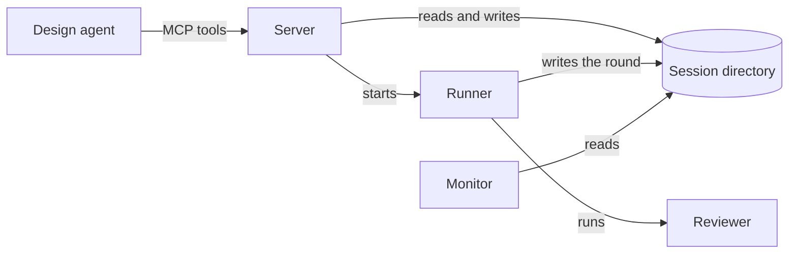
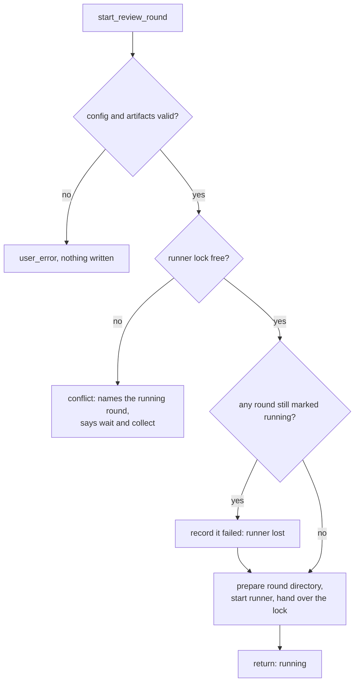

# Sessions on Disk

Mercurius writes nearly everything it produces to files... snapshots, prompts, config captures, round logs, notes. The one thing it keeps to itself is the session: a map in the server's memory that binds a session id to its rounds, its reviewer output, and its decisions. A stdio MCP server lives exactly as long as its harness lets it, so that map is the least durable thing in the system, and it is the thing everything else hangs from.

This spec moves the session onto disk completely. The server holds nothing between tool calls. Attaching to a session is naming its id; detaching is nothing at all. A round runs in its own process and finishes whether or not the server that started it is still there.

Nothing here is implemented. Today the registry is in memory only, a round is a goroutine inside the server, and a fresh server process knows no sessions.

## Where this came from

On 2026-08-18, four review sessions in a row were lost under the pi harness. Its MCP adapter shuts a stdio server down after ten minutes without a tool call, and the one stretch of a review arc that reliably runs longer than that is the human triage between `collect_round` and `record_round_notes`. The notes call met a fresh process with an empty map, and the tools answered `not_found` for sessions whose whole record sat intact on disk.

The first answer was recovery: keep the registry in memory, and rebuild a session from disk when a lookup misses. That design — the earlier session-rehydration spec, which this one replaces — leaves two models of a session in the system, the live one and the rebuilt one, and nothing forces them to stay the same. The rebuild also runs only after something has already gone wrong, which makes it the least-exercised path in the broker at exactly the moment it matters. This spec takes the other road and removes the thing that needed recovering.

A second problem rides along. When a server dies while a round is running, the usual outcome in real use is that the agent quietly launches another reviewer. Nobody knows how often that happens, because the failure is absorbed before the operator sees it. The design below keeps the round alive through the server's death, and refuses the duplicate launch out loud.

## The model

There are three kinds of process, and each lives exactly as long as its job.

The **server** is the MCP surface. It lives as long as the harness allows and holds one thing: where its configuration lives. Every tool call reads the config, finds the session directory, reads what it needs, acts, and writes.

The **runner** is one round. `start_review_round` starts it as a separate mercurius process, detached from the server, and it lives until the round reaches an outcome.

The **reviewer** is the runner's child... `codex`, `claude`, or `pi`, exactly as today.



The session directory is the only thing these processes share. There is no protocol between the server and the runner; the round directory is the whole interface.

## One home per fact

Once memory is gone, every fact needs a place on disk, and two places that can disagree are the old problem again. So each fact gets exactly one home, and the homes are divided by who writes them.

```text
<log_destination>/
  runner.lock              held by the live runner; names its session and round
  <session_id>/
    session.json           the session's own facts: opened, closed
    _synopsis.md           written by close_session
    round-01/
      _state.json          running, completed, or failed; timings, pids, error
      _run.json            inputs, written by the server: the resolved reviewer, where it came from, max_findings, the artifact manifest
      _config.yaml         the project's mercurius.yaml, verbatim
      _prompt.md
      design
      work-order
      _review.json         outcome, written by the runner on success
      _round.md
      _raw.txt             raw reviewer output, written by the runner on failure
      _runner.log          the runner's own log
      _notes.json          triage, written by a server later
      _notes.md
```

`session.json` carries what belongs to the session and to nothing else: its id, when it opened, whether and when it closed. Servers write it.

A round directory carries everything about that round. The server writes the inputs and the round's first state when the round starts. The runner writes the outcome and the final state. A server writes the notes later, during triage. `_state.json` is written last, so a round that says `completed` has its outcome on disk.

`status.json` goes away. It was a summary of memory, and with no memory there is nothing for it to summarize that isn't already in a file of its own. The monitor reads `session.json` and the round states directly.

The human documents stay, and each gets a machine twin written in the same motion: `_review.json` beside `_round.md`, `_notes.json` beside `_notes.md`. The twins carry the raw reviewer output, the usage notes, the commentary, and the decisions. The artifact manifest is an input, known before the reviewer runs and just as true of a round that fails, so it lives in `_run.json`. Mercurius reads the twins and never parses its own markdown back... a parser over `_round.md` would make a document written for people into a wire format, permanently. The refs a round accepts for decisions are not stored; they recompute from the raw output through the same schema parse that produced them the first time.

## The runner

`start_review_round` does its checking up front. The server resolves the configuration, validates the artifacts, takes the project's runner lock, prepares the round directory with its inputs, hands the round and the lock to a runner, and returns. Anything that fails before the runner starts is returned directly from the tool call and leaves no round behind.

The runner is mercurius itself, started in its own process session so that a harness taking down the server does not take the round with it. The round directory is its entire input. The server writes the settings it resolved into `_run.json`, and the runner builds its reviewer from that file and nothing else, so what a round ran with and what the record says it ran with cannot differ. `_config.yaml` stays what it is today, a verbatim copy of the project file kept beside the rendered prompt.

From there the runner does what the round goroutine does today: dispatch the reviewer, validate the output against the schema and the finding limit, write the outcome. Its own log lands in the round directory, since a detached process has no stderr anyone will read.

Three things are new, and all three exist because nothing is attached to a runner that could stop it.

A round has a **timeout**. There is none today. A reviewer that hangs under the current design dies when its harness does, at best; under a detached runner it would run until someone killed it by hand. On timeout the runner kills its reviewer. If the reviewer had already produced a valid review, the round completes with it... a finished review is not thrown away because its process failed to exit. Otherwise the round is recorded as failed. The timeout is a field of the reviewer block, because how long a review takes depends on which reviewer runs it, and it defaults to twenty minutes. That errs long on purpose... a timeout that fires early throws away a good review, while one that fires late only holds the lock a while longer.

The reviewer's life is **tied to the runner's** by the kernel, so that when a runner dies its reviewer dies with it. The pids of both are recorded in the round's state, but for the operator's eyes — to see what is running, or to kill it deliberately. Mercurius never kills a process by a recorded pid. Pids get reused, and a round found dead days later would be hunting a number that now belongs to something else.

When the runner finishes, it notes whether the server that started it is still alive, and records the answer on the round. A round that **outlived its server** is a round the old design would have lost. The synopsis shows the mark per round, which is the evidence for how often this happens.

## The launch guard

One round runs at a time per log destination. The runner holds a kernel file lock on `runner.lock` for its whole life, and the kernel releases that lock when the runner exits, however it exits. The lock answers the two questions the design needs answered, without guessing at pids and without heartbeats.

*Is a round running?* If the lock is held, yes. `start_review_round` refuses with `conflict`, and the refusal says which session and round is running, how long it has been running, whether it was started by the server now answering, and what to do: wait, then call `collect_round` on that session. The round is not lost, so the right move is to collect it rather than relaunch it, and the error says so.

*Is this round dead?* A round whose state says `running` while the lock is free has no runner. Whichever server next looks at it takes the lock, records the round as failed with a clear reason, and lets go. The monitor shows such a round as lost without writing anything.

The lock is therefore also the permission to write a running round's state. Nothing touches `_state.json` without holding it.



The guard is project-wide rather than per-session on purpose. The existing check — "a review round is already running" — is per session, and the path duplicates actually take is a new session: the agent loses the id, or gets an error, opens a fresh session, and launches there. A per-session guard never sees that.

The cost is that two harnesses cannot run reviews at the same moment in one project. That matches how the tool is already used: `mercurius.yaml` is one file per project and its `review_focus` describes one arc. Separate worktrees each resolve their own log destination, so they each get their own lock.

## Failed rounds stay

Today a failed round is erased... its directory is removed and its number is reused. Under this design a round that was started keeps its directory and its number, whatever happened to it. Round 2 fails, stays on disk as failed, and the retry is round 3.

The failure is recorded in the round's `_state.json`, and whatever the reviewer produced before failing goes in `_raw.txt` beside it. `collect_round` on a failed round returns that failure, from disk, for as long as the directory exists. The synopsis lists failed rounds with the rest, so it shows the trajectory that actually happened.

This also closes `status-json-error-bloat.md`. That problem was megabytes of raw reviewer output stored inline in `status.json` because a discarded round had nowhere else to put it. A failed round now has a directory, and the output has a file.

## Configuration is per round

The reviewer and `max_findings` join the calibration: resolved from configuration when a round starts, and recorded on that round. Today the reviewer is built once at server startup, so an edit to the config takes effect only if the server happens to restart, and the session-level record names whichever reviewer the closing process was configured with. With sessions spanning server processes as a matter of course, that would get worse.

A session no longer has a reviewer. Rounds do. `session_status` and the synopsis report the reviewer per round, and `open_session` reports what is configured at that moment, as information.

### The reviewer belongs to the installation

Which reviewer runs is a fact about the machine, not about the project: which harnesses are installed, which model the operator wants, how long that model takes. Today it lives in `mercurius.yaml`, which agents scaffold fresh for every arc, so it has to be set correctly every time by whoever writes the file, and the bootstrap template bakes a model name into every project it touches.

The `reviewer` block moves to a user-level file, `~/.config/mercurius/config.yaml`, set once. Nothing else moves. Calibration, `max_findings`, and `log_destination` describe the project and the arc, and stay in `mercurius.yaml`. `mercurius bootstrap` stops writing a reviewer into the project template.

A project can still choose its own reviewer, with a `reviewer_override` block in `mercurius.yaml`. The key is deliberately not `reviewer`. If it were, every stale template and every agent habit would produce an override, and overriding would be the accident rather than the decision. Instead a plain `reviewer` block in `mercurius.yaml` is a `user_error` that says the reviewer now lives in the user-level file and to remove the block. The loader already rejects renamed keys this way.

An override replaces the whole block, timeout included. Merging field by field would let a project's `model` land on the installation's different `impl`.

When an override is in effect it is said everywhere the reviewer is named. `open_session` and `start_review_round` report the reviewer's source as the user config or a project override, and the launch response tells the agent to tell the operator when it is an override. The monitor, the round's `_run.json`, and the per-round reviewer line in the synopsis carry the same.

If neither file names a reviewer, `start_review_round` returns a `user_error` naming the user-level path.

### The server starts without a config

Because the server reads the config per call instead of at startup, a missing or broken `mercurius.yaml` becomes a tool error with a reason instead of a dead server. That matters more than it sounds. The config is scaffolded per review arc and removed afterward, so today the server fails at launch in every project between arcs, and the harness reports only a closed connection. Under this design the agent gets a `user_error` naming the missing file, writes it, and calls again.

## What changes on the tool surface

The six tools stay, with the same names and the same requests.

`open_session` no longer fails for want of a reviewer, and reports the current config as information rather than as a property of the session. The `review_context_present` and `review_focus_present` booleans it returns describe the config at that moment and are not stored on the session; `session_status` drops them, and the synopsis reports calibration presence per round.

`start_review_round` returns artifact and config problems directly. It gains the project-wide `conflict` refusal described above. It reports the reviewer the round is running with and where that reviewer came from. The path it returns for monitoring points at the round's `_state.json`.

`collect_round` returns a failed round's failure durably, and still answers `conflict` while a round is running.

`session_status` lists every round with its state, failed ones included, and its reviewer and the reviewer's source.

`close_session` renders the synopsis from disk, so it works from any server process. The synopsis gains failed rounds, the per-round reviewer and its source, and the outlived-its-server mark.

Tool-call refusals — a `conflict`, a `user_error` — go back to the caller and are not stored anywhere. The session-level `last_error` goes away; a round's failure lives with the round.

The monitor keeps its three forms. `--wait` watches one round's state until it reaches an outcome.

## Scenarios

**The arc, replayed.** The adapter kills the server during triage. `record_round_notes` arrives at a fresh process, which reads the session directory, validates the decision refs against the round's `_review.json`, and writes the notes. `close_session` renders a full synopsis. Nothing was recovered, because nothing was lost; the fresh process did what any process does.

**The server dies mid-round.** The agent starts a round and the reviewer settles into an eight-minute review. At minute five the harness restarts. The runner doesn't notice. At minute eight it writes the outcome, sees that the server which started it is gone, and marks the round as having outlived it. The agent calls `collect_round` from the new server and gets the review.

**The duplicate launch.** Same death, but the agent has lost track of the session. It opens a new one and calls `start_review_round`. The lock is held. The call returns `conflict`: round 2 of session `s_xK3p9q` has been running for six minutes, started by a server other than this one; wait, then collect it there. The agent reports that to the operator instead of spending a second review.

**The runner dies.** The runner is killed outright. The kernel releases the lock and takes the reviewer down with it. The round's state still says `running`. The next `start_review_round` finds the lock free and that round still marked running, records it as failed with the reason `runner_lost`, and starts round 3. Round 2 stays on disk with its inputs and its log.

**The hung reviewer.** A reviewer stops making progress. Every launch in the project is refused with a `conflict` naming the round and the runner's pid. At the timeout the runner kills the reviewer, records the failure, and exits, and the next launch goes through. An operator who doesn't want to wait kills the pid the error named.

**Two harnesses, one session.** An agent in one harness runs a round and collects it. The operator switches harnesses for triage, and an agent there records the notes and closes the session. Neither server knew about the other, and neither needed to.

**No config yet.** A planning agent calls `open_session` before scaffolding `mercurius.yaml`. The call returns `user_error` naming the path it looked for. The agent writes the file and calls again, with no reconnect.

**The stale template.** An agent scaffolds `mercurius.yaml` from habit, reviewer block and all. `start_review_round` returns `user_error`: the reviewer is set per installation, remove the block. The agent removes it, and the round runs on the reviewer the operator chose once.

**The deliberate override.** The operator wants a second opinion on one arc and adds a `reviewer_override` block naming a different harness. The launch response says the round is running on a project override, and the agent says so. The synopsis marks every round that ran that way. When the block comes out, the next round is back on the installation's reviewer.

## Seam census

- **Session state and process** — *call:* no registry; disk is the only session state, read per tool call. *Why:* a recovery path beside a live model is two models and a path that runs only when things are already broken. *Revisit:* none foreseen at this scale.
- **Server and runner** — *call:* separate processes; the server prepares a round's inputs, the runner produces its outcome, and the round directory is the whole interface. *Why:* the round has to outlive the server, and a directory is an interface anyone can inspect. *Revisit:* a real want for cancellation or live progress, which a directory cannot carry well.
- **Liveness** — *call:* a kernel file lock held for the runner's life; no pid probing, no heartbeats, no lock files that need staleness repair. *Why:* the kernel releases it on death, and there is no reuse ambiguity. *Revisit:* a log destination on a filesystem where such locks don't hold, or a platform without them.
- **Write permission** — *call:* nothing writes a running round's state without holding the runner lock; the monitor never writes. *Why:* it keeps one writer per file at any moment without a second mechanism. *Revisit:* none foreseen.
- **Concurrency scope** — *call:* one running round per log destination. *Why:* the config is one per project, and the narrower guard misses the new-session path. *Revisit:* a demonstrated need for concurrent rounds in one tree, at which point the lock moves into the round.
- **Reviewer lifetime** — *call:* tied to the runner by the kernel; recorded pids are for people, never for automated kills. *Why:* killing by a recorded pid can hit a recycled one. *Revisit:* a build for a platform without a parent-death arrangement.
- **Machine and human record** — *call:* machine twins written beside the human documents; markdown is never parsed back. *Why:* a parser makes prose a wire format and couples the human document to it for good. *Revisit:* none foreseen.
- **Error by tier** — *call:* failures before the runner starts return from the tool call and leave nothing on disk; failures after it live in the round's state and return from `collect_round`; refusals are not stored; config problems are tool errors and never a startup death; a corrupt `session.json` is an `internal_error`. *Why:* each lands where the party who can act on it will see it. *Revisit:* none foreseen.
- **Reviewer selection** — *call:* the user-level config owns the `reviewer` block; a project overrides only through a distinct `reviewer_override` key, which replaces the whole block; a plain `reviewer` block in the project file is an error. *Why:* the reviewer is a fact about the installation, and an override that shares the default's key cannot be told from a habit. *Revisit:* a second setting that turns out to belong to the installation.
- **Timeout surface** — *call:* a field of the reviewer block. *Why:* it bounds the reviewer and depends on which reviewer runs, so it travels with it. *Revisit:* none foreseen.

## Deferred (and why)

- **A `cancel_round` tool.** The timeout bounds a runaway round and the recorded pids make a deliberate kill possible. A tool for it waits on a demonstrated want.
- **Concurrent rounds in one project.** Not needed today, and separate worktrees already get separate locks.
- **Reading sessions written under the old layout.** Sessions are per-arc and short-lived; a session directory without `session.json` answers `not_found` with a detail saying why. No migration, no backfill parser.
- **Resuming a round whose runner died.** The retry starts from zero. Partial reviewer output is kept for diagnosis, not for continuation.
- **A cross-arc record of rescued rounds.** The synopsis mark covers one arc, and the launch guard reports the cases that matter as they happen. A durable tally would need a home outside the project, which mercurius has never had.
- **Guarding against a reviewer switch mid-arc.** Per-round config means an edit to the user-level file, or a `reviewer_override` added or removed, takes effect on the next round. It is visible per round in the synopsis; nothing prevents it.
- **Other user-level settings.** Only the reviewer moves. Anything else waits until it shows the same shape... set per installation, and wrong when left to whoever scaffolds the project file.
- **Platforms beyond Linux.** The lock and the parent-death arrangement are specified as behaviors, and the release build is Linux-only today.
- **Queryable session history.** This is operational state, kept so a session survives its processes. The broker's refusal to keep a corpus of past sessions is unchanged.

## Related

- `status-json-error-bloat.md` — resolved by this design; remove it when this is built.
- `web-monitor-and-trajectory.md` — builds on `status.json` as its substrate, and will read `session.json` and the round states instead.
- `review-round-modes.md` (panel mode) and the `quorums` roadmap card — one runner runs a round however many reviewers it dispatches, and `_review.json` holds a list of reviewer results from the start.
- `fidelity-gate.md` — leans on the no-corpus posture this spec leaves intact.
- `docs/current/` (architecture, operations, mcp-tools, configuration, user-guide, agent-guide) — the surfaces this re-synthesizes into when built.
